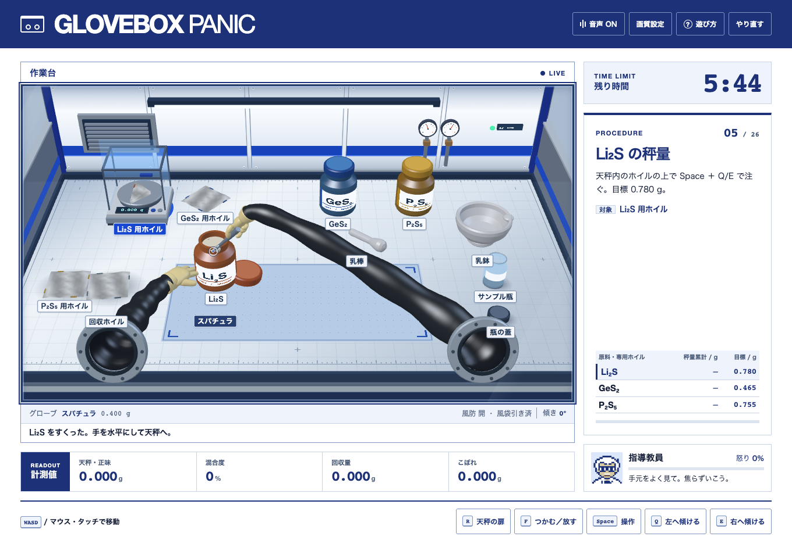

[公開版で遊ぶ](https://ks250206.github.io/weigh-mix-hand-sim/)

# GLOVEBOX PANIC / 秤量ハンドシミュレーター

黒いグローブに薄黄色のクアラテック手袋を重ね、Li₁₀GeP₂S₁₂（LGPS）用の混合原料を 2.000 g 調製する6分間の3Dゲームです。道具を両腕の間の作業面に並べ、左奥の風防付き天秤で原料を一種類ずつ量り、乳鉢で混ぜて瓶に回収します。ゲームのゴールは混合原料の密栓です。


## 配合

Li₂S・GeS₂・P₂S₅ の物質量比は **5：1：1** です。Li・Ge・P・S の原子量から2.000 g仕込みへ換算し、1 mg単位に丸めたゲーム内目標量を使います。[CIAAWの原子量表](https://ciaaw.org/abridged-atomic-weights.htm)

| 原料 | 目標質量 |
| --- | ---: |
| Li₂S | 0.780 g |
| GeS₂ | 0.465 g |
| P₂S₅ | 0.755 g |

## 操作

| 操作 | キーボード・マウス | タッチ |
| --- | --- | --- |
| 手の移動 | マウス、WASD、矢印キー | 作業台をなぞる |
| つかむ／置く | 器具の近くでクリックまたは F | 「つかむ／放す」 |
| 天秤の風防を開閉 | 天秤の近くで R | 「天秤の扉」 |
| ホイルを折る | Space を押しながら折り目をなぞり、1回ごとに離す | 「折る」を押しながら別の指でなぞり、1回ごとに離す |
| 開栓・風袋引き・秤量値の記録・密栓 | 対象の前で Space を長押し | 「操作」を長押し |
| すくう・混ぜる | Space を押したまま手を動かす | 「操作」を押しながら別の指で移動 |
| 粉を注ぐ | 受ける器具の上で Space と Q または E を長押し | 「操作」と左右どちらかの傾きボタンを長押し |

1. Li₂S 用の正方形のホイルを手前の枠に運び、放します。Space を押しながら左上から右下へ対角線をなぞると、2層の三角形になります。一度 Space を離し、三角形の直角の頂点から長辺の中央までなぞってもう一度折ると、4層の三角形になります。各回とも、画面の破線をはさむ角から反対側の角へ手を動かして折ることもできます。
2. 風防を開けてホイルを皿に載せ、閉じて風袋を引きます。表示が 0.120 g から 0.000 g に変わったら、原料瓶を手前へ移して開栓します。スパチュラの先を瓶口に合わせ、Space を押して粉に差し込み、手前へ短く引いてすくいます。Space を離して持ち上げ、風防を開けた天秤内のホイルに注ぎます。
3. 目標量に達したら風防を閉じ、表示を記録します。再び開け、ホイルを取り出して粉を乳鉢へ注ぎます。空いた使用済みホイルは F または「廃棄する」で片付けます。GeS₂ と P₂S₅ も、それぞれの専用ホイルを新しく折り、風袋引きから繰り返します。追加秤量にも新しい正方形のホイルを使います。
4. 乳棒を持ち、乳鉢の内側で小さく往復して混ぜます。回収用のホイルも2回折り、乳鉢から混合粉を移してサンプル瓶に注ぎ、密栓します。



スパチュラは指先で柄を挟み、乳棒は親指を回して握ります。柄に手を合わせてクリックまたは F で持ち上げると、カーソルで道具の先端を狙えます。道具は置いた場所に残ります。持ち替えるときは空いている場所に置いてください。倒れた器具は空いた手で起こせます。粉をこぼして不足した場合は追加秤量に戻り、瓶に入った分は残ります。ホイルの折り目、粉が落ちる音、風防の開閉音は画面右上でオン・オフを切り替えられます。「遊び方」を開くとタイマーが止まります。

## 画質設定

タイトル画面と実験中の「画質設定」から、描画解像度（75〜200%）、FPS 上限（30・60）、アンチエイリアス（なし・FXAA）、道具の影、粉の表示量を変更できます。「FPS を表示」で実際の描画フレームレートを確認できます。「軽量」「高画質」で画質を一括設定でき、「初期値に戻す」で既定の設定に戻せます。変更はすぐに反映され、このブラウザーに保存されます。実験中は設定を閉じるまでタイマーが止まります。

## ローカル実行

Node.js 26.13.0、pnpm 12.21.0 を使用します。

```sh
pnpm install --frozen-lockfile
pnpm dev
pnpm test
pnpm build
```

GitHub Actions が main への push でテスト・ビルドを実行し、dist を GitHub Pages に公開します。

HUD と実験室の配色には Science Blue（#1C3177）と白を使っています。[配色の参考にした Science Tokyo デザインシステム](https://design-system.isct.ac.jp/ja/brand/elements/color/color-system)

## モデルの範囲

作業台は PixiJS と @pixi/3d で描画し、前面窓と平行なグローブポートのフランジ、天秤の風防、粉へ差し込むスパチュラ、瓶や乳鉢を支える左手を表示します。道具の接触と滑りには Matter.js の2次元剛体を使用します。移動中の粉は最大48個の代表粒子で描画します。Matter.js が重力による落下と粒同士・容器・作業面との衝突を計算し、静止した粒の計算を止めます。注ぎ口の位置・手の横速度・受け口の広さから粉の落下範囲を求め、縁を外れた分はこぼれとして計上します。秤量値には、原料・容器別に記録したグラム単位の質量を使います。スパチュラには一杯分と不足量の上限があります。回収率は元瓶から取り出した全量に占める瓶詰め量です。
