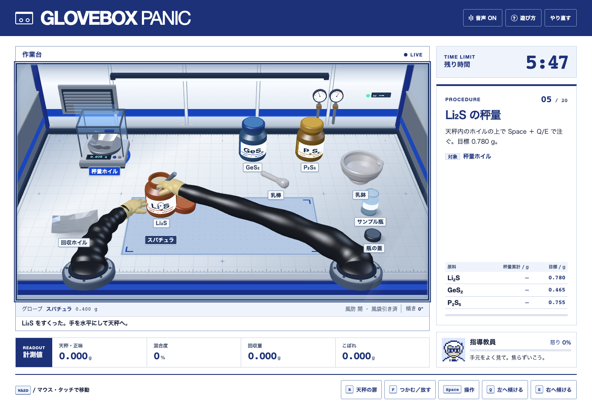

[公開版で遊ぶ](https://ks250206.github.io/weigh-mix-hand-sim/)

# GLOVEBOX PANIC / 秤量ハンドシミュレーター

黒いグローブに薄黄色のクアラテック手袋を重ね、Li₁₀GeP₂S₁₂（LGPS）用の混合原料を 2.000 g 調製する6分間の3Dゲームです。道具を両腕の間の作業面に並べ、左奥の風防付き天秤で原料を一種類ずつ量り、乳鉢で混ぜて瓶に回収します。ゲームのゴールは混合原料の密栓です。



## 配合

Li₂S・GeS₂・P₂S₅ の物質量比は **5：1：1** です。Li・Ge・P・S の原子量から2.000 g仕込みへ換算し、1 mg単位に丸めたゲーム内目標量を使います。[CIAAWの原子量表](https://ciaaw.org/abridged-atomic-weights.htm)

| 原料 | 目標質量 |
| --- | ---: |
| Li₂S | 0.780 g |
| GeS₂ | 0.465 g |
| P₂S₅ | 0.755 g |

## 操作

| 操作 | キーボード・マウス | タッチ |
| --- | --- | --- |
| 手の移動 | マウス、WASD、矢印キー | 作業台をなぞる |
| つかむ／置く | 器具の近くでクリックまたは F | 「つかむ／放す」 |
| 天秤の風防を開閉 | 天秤の近くで R | 「天秤の扉」 |
| 折る・開栓・風袋引き・秤量値の記録・密栓 | 対象の前で Space を長押し | 「操作」を長押し |
| すくう・混ぜる | Space を押したまま手を動かす | 「操作」を押しながら別の指で移動 |
| 粉を注ぐ | 受ける器具の上で Space と Q または E を長押し | 「操作」と左右どちらかの傾きボタンを長押し |

1. 秤量ホイルを手前の枠に運び、放してから縁を折ります。天秤の風防を開け、ホイルを皿に載せます。風防を閉めて風袋を引くと、表示が 0.120 g から 0.000 g に変わります。
2. 原料瓶を手前へ移して開栓します。スパチュラの先を瓶口に合わせ、Space を押して粉に差し込み、手前へ短く引いてすくいます。Space を離して持ち上げ、風防を開けた天秤内のホイルに注ぎます。
3. 目標量に達したら風防を閉じ、表示を記録します。再び開け、ホイルを取り出して手前の乳鉢に移します。同じホイルを天秤に戻し、残りの原料を量ります。
4. 乳棒を持って乳鉢の内側で小さく往復します。均一になったら新しいホイルとサンプル瓶も手前に運び、回収して密栓します。

道具は置いた場所に残ります。持ち替えるときは空いている場所に置いてください。倒れた器具は空いた手で起こせます。粉をこぼして不足した場合は追加秤量に戻り、瓶に入った分は残ります。「遊び方」を開くとタイマーが止まります。

## ローカル実行

Node.js 26.13.0、pnpm 12.21.0 を使用します。

```sh
pnpm install --frozen-lockfile
pnpm dev
pnpm test
pnpm build
```

GitHub Actions が main への push でテスト・ビルドを実行し、dist を GitHub Pages に公開します。

HUD と実験室の配色には Science Blue（#1C3177）と白を使っています。[配色の参考にした Science Tokyo デザインシステム](https://design-system.isct.ac.jp/ja/brand/elements/color/color-system)

## モデルの範囲

作業台は PixiJS と @pixi/3d で描画し、天秤の風防、粉へ差し込むスパチュラ、瓶や乳鉢を支える左手を表示します。作業面での道具の接触と滑りには Matter.js の2次元剛体を使用します。粉は原料・容器別の質量として移動し、見た目には粒子を使います。スパチュラには一杯分と不足量の上限があります。回収率は元瓶から取り出した全量に占める瓶詰め量です。
